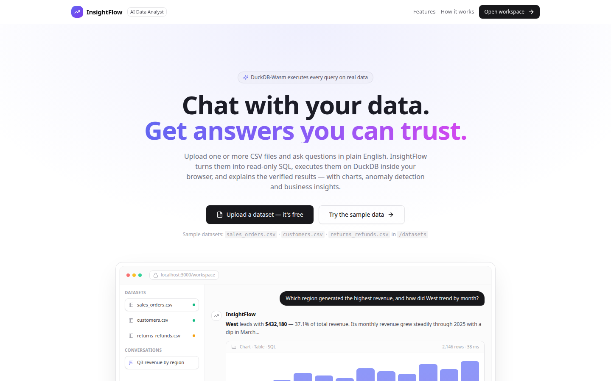
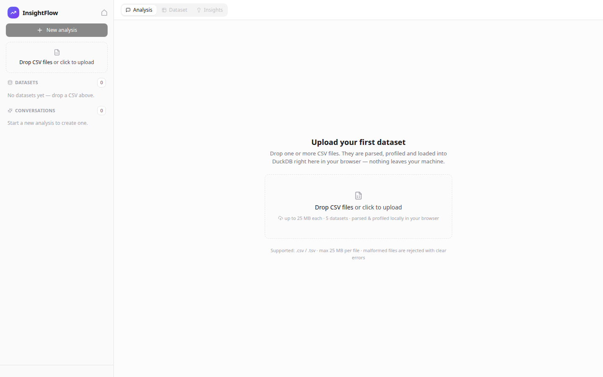
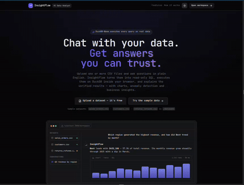
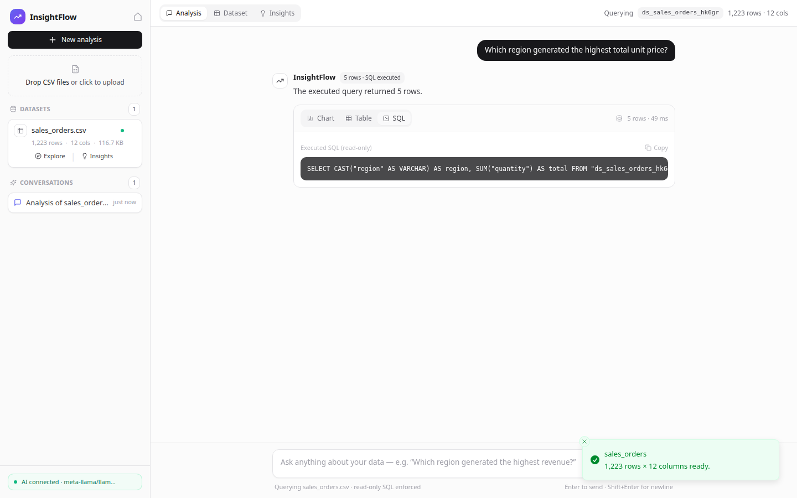
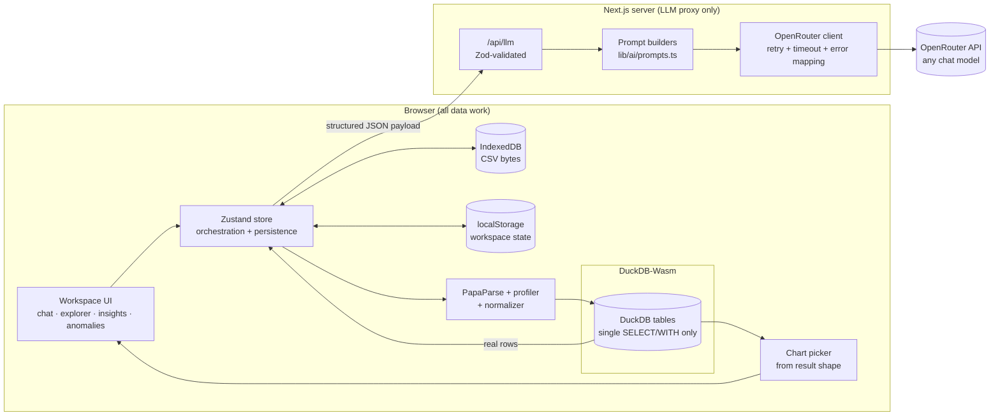
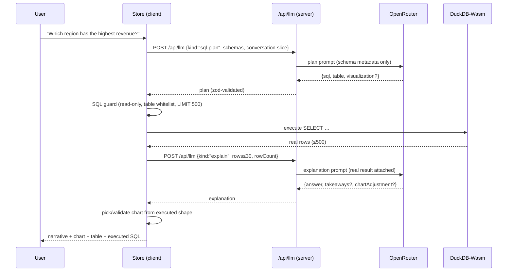
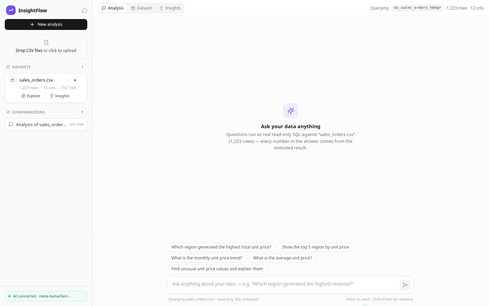
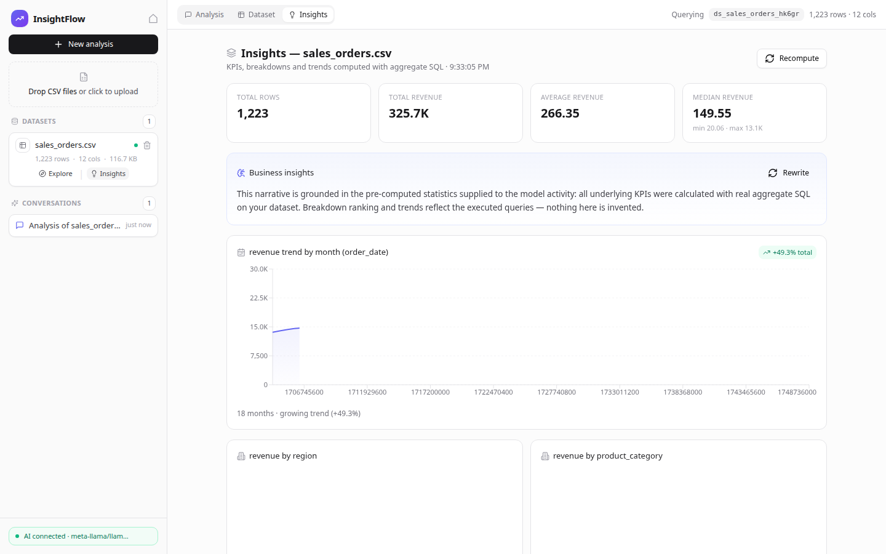
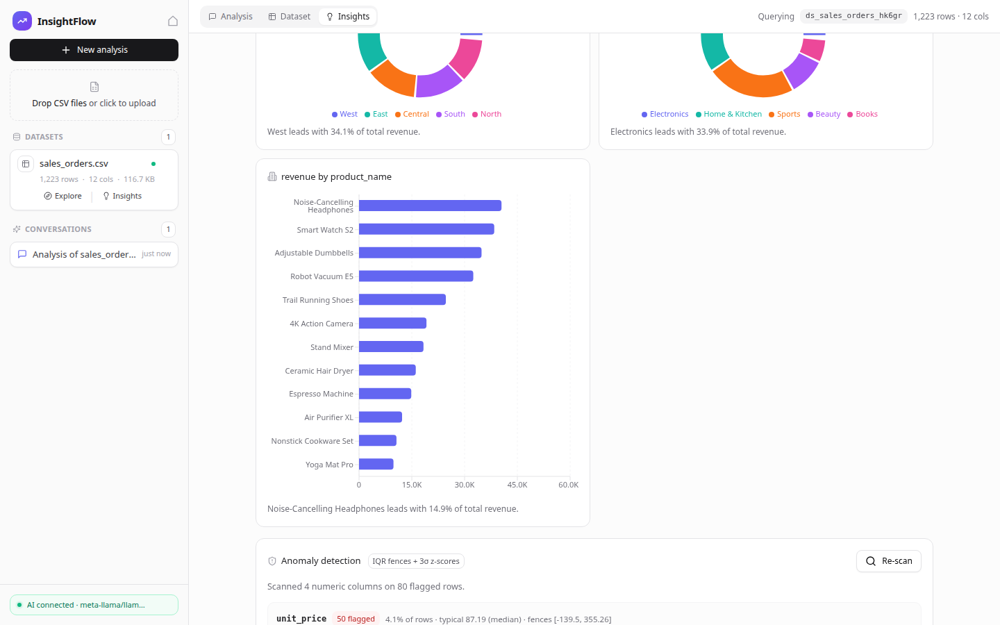

# InsightFlow — AI-powered data insights

Chat with your CSV files. Ask questions in plain English, get answers computed by **real SQL on your actual data** — never hallucinated numbers.

```
Upload CSVs → profile → ask in English → LLM writes DuckDB SQL → read-only guard →
DuckDB-Wasm executes on your rows → chart + table + narrative grounded in the result
```

| | |
|---|---|
| **Stack** | Next.js 15 (App Router) · TypeScript · Tailwind · shadcn-style UI · Zustand · Recharts · DuckDB-Wasm · PapaParse · Zod · OpenRouter |
| **Privacy** | Parsing, profiling, storage and query execution run **entirely in your browser**. The only server call is the LLM proxy (your CSV bytes never leave the client — the server sees schema metadata only). |
| **AI** | Any OpenRouter model; key lives server-side only. Works fully without a key (deterministic fallback + all analytics views). |





## Demo & Screenshots

- 🎥 **Demo video:** [Watch full demo (project.mp4)](https://raw.githubusercontent.com/muskan-wagh/InsightFlow-AI-powered-data-insights./main/docs/project.mp4) (short walkthrough of upload → question → chart → insights → anomalies)


- 🌐 **Live app:** _add link if deployed_
- 📸 **Screenshots:** see [`docs/screenshots/`](docs/screenshots/) (landing, upload, answer with chart, explorer, insights, anomalies, dark mode)

> The user uploads the demo video / live link here; screenshot files are already committed under `docs/screenshots/`.

## Contents

1. [Quickstart](#quickstart)
2. [What it does](#what-it-does)
3. [Architecture](#architecture)
4. [Security model: the SQL guard](#security-model-the-sql-guard)
5. [The analysis pipeline](#the-analysis-pipeline)
6. [Testing](#testing)
7. [Docker](#docker)
8. [Environment variables](#environment-variables)
9. [Sample datasets](#sample-datasets)
10. [Assumptions & limitations](#assumptions--limitations)

---

## Quickstart

```bash
git clone <this-repo>
cd InsightFlow-AI-powered-data-insights.

# 1. Install (postinstall copies the DuckDB-Wasm bundle into public/)
npm install

# 2. (Optional, for AI answers) add your OpenRouter key — server-side only
echo 'OPENROUTER_API_KEY=sk-or-...' > .env.local

# 3. Run
npm run dev          # → http://localhost:3000
```

Open the workspace, drop `datasets/sales_orders.csv` (or any CSV), and ask:

> *Which region generated the highest revenue?* → table/chart/SQL → *"Show its monthly trend"*

**Without an API key** everything still works: upload, profiling, dataset explorer, insights dashboard, anomaly detection, and chat responses carry the verified data table/chart (the narrative layer is skipped with a notice).



## What it does

**1. Multi-file CSV ingestion.** Drag several CSVs; each becomes a DuckDB table (`ds_<name>_<hash>`). Files are validated (format, size, session limits), parsed with delimiter auto-detection, header sniffing, ragged-row padding, BOM stripping and quoted-field handling.

**2. Instant data profiling** (computed in a Web Worker-free single pass: 50k rows in <1s):
column type inference (integer/decimal/date/datetime/boolean/categorical/text), missing/`N/A` handling, min–max stats, distinct counts, date ranges, duplicate-row detection, per-dataset quality score.

**3. Natural-language analysis.** Requests are proxied to OpenRouter with a compact schema payload (never your raw data — sample counts and types only). The model returns a JSON SQL plan, which is validated, executed on DuckDB-Wasm, and the *result* (not the model's imagination) is what you see.
Failed SQL gets one corrective retry with the engine's error message.

**4. Charts that fit the result.** The visualization is picked from the *executed* result shape (trend → line, category → bar/pie, two numerics → scatter). The model may request an adjustment, which is re-validated against the real columns.

**5. Statistical anomaly detection** (100% local, no LLM): per-numeric-column IQR fences **and** 3σ z-scores, with every flagged row explainable in plain numbers ("value 900 exceeds the upper fence 41.4 by 21.7× the IQR"). Click a record to jump to the offending row in the table.

**6. Insights dashboard.** Automatically generated KPI cards (row count, numeric aggregates, date range), a time-series trend when a date column exists, a categorical breakdown, duplicate + quality reporting.

**7. Context-aware follow-ups.** Conversations are per-dataset; ~4 recent exchanges (question + executed SQL) accompany each new question, so *"now show its monthly trend"* resolves what *it* is.

**8. Dataset explorer.** Per-column profile cards, sample values, DuckDB-powered preview of the first rows, sanitized-column-name mapping, search and column filters.

**9. Persistence.** Dataset CSV bytes live in **IndexedDB**; dataset/conversation state in **localStorage** (zustand persist). Reload the page and your workspace rehydrates (files stream back into DuckDB automatically).

## Architecture



**Key decision — compute in the browser, narrate on the server.** The model never sees raw rows; it receives schema metadata (types/counts/distinct + numeric ranges) and the conversation slice. For `explain` it receives the ≤30 sample result rows of the query it planned. All authoritative numbers in the UI come from DuckDB, so a hallucinating model can only impact *which* question gets asked, not *what answer* is displayed.

## Security model: the SQL guard

Every generated SQL string passes `lib/validation/sql-guard.ts` **before** execution:

| Check | Behavior |
|---|---|
| Statement shape | Must start with `SELECT`/`WITH` — a single statement, no trailing separator games |
| Destructive keywords | `DROP/DELETE/INSERT/UPDATE/CREATE/ALTER/ATTACH/COPY/PRAGMA/CALL/EXPORT…` scanned **after** stripping literals/comments so `where status = 'DROP'` isn't a false positive and `'; DROP TABLE —` can't sneak through |
| Table whitelist | `FROM`/`JOIN` references (bare, `db.table`, quoted `"name"`) must exist among registered datasets; CTE aliases auto-allowed |
| FORCED result cap | Query is wrapped: `SELECT * FROM (…) AS _insightflow_result LIMIT 500` (user LIMIT kept if lower); the DuckDB engine itself runs under a `1.2GB` memory limit |

The guard ships 28 dedicated unit tests, including stacked-statement tricks, keyword-in-literal spoofing and unknown-table refs.

## The analysis pipeline



Every step degrades gracefully: plan fails → one corrective retry → helpful error; explain fails → deterministic data-only answer; key missing → all analytics still available.

## Testing

```bash
npm test        # 84 unit tests (vitest)
npm run test:e2e # 11 end-to-end checks (Playwright headless)
```

**Unit tests (84 passing)** — `tests/`:

- `csv-profiler.test.ts` — valid/invalid uploads, quoted commas, BOM, delimiter sniffing, empty/header-only rejection, type classification, missing & duplicate counts, numeric stat extraction, identifier sanitization, money/percent/parenthesis normalization, date parsing without day shifts, DuckDB type derivation, 50k-row performance
- `sql-guard.test.ts` — allowed reads, CTE chains, joins, LIMIT preservation, literal/comment spoofing defenses, destructive statements, stacked statements, unknown tables, multi-dataset validation
- `anomaly.test.ts` — quartiles/fences, IQR & z-score flags, both-method stamping, null handling, explanation snapshots with real numbers
- `pipeline.test.ts` — chart picking from result shapes, spec validation, `extractJson` on fenced/prose responses, conversation-slice construction, schema payloads, zod AI schemas, upload constraints

**E2E (headless Chromium, 11 checks)** — `tests/e2e/e2e.mjs`: landing → upload real sample → LLM answer (with local OpenRouter-compatible mock: `npm run mock:llm`) → chart/table/SQL tabs → context follow-up → explorer → insights KPIs → anomaly scan → new session. Screenshots land in `.e2e-artifacts/` (mirrored in `docs/screenshots/`).

| Workspace upload state | Insights dashboard | Anomaly records |
|---|---|---|
|  |  |  |

## Docker

```bash
export OPENROUTER_API_KEY=sk-or-...   # optional
docker compose up --build             # → http://localhost:3000
```

Multi-stage build (deps → build → slim runtime, non-root user). The DuckDB-Wasm bundle is regenerated by `postinstall` inside the image, so no binaries are baked into git.

## Environment variables

| Variable | Where | Required | Purpose |
|---|---|---|---|
| `OPENROUTER_API_KEY` | server (`.env.local`) | for AI answers | OpenRouter API key — never exposed client-side |
| `OPENROUTER_MODEL` | server | no | Any OpenRouter slug (default `meta-llama/llama-3.3-70b-instruct`) |
| `OPENROUTER_BASE_URL` | server | no | Override for self-hosted proxies / the local mock |
| `NEXT_PUBLIC_APP_URL` | server | no | `HTTP-Referer` sent to OpenRouter |

## Sample datasets

`datasets/` (generated by `npm run generate:samples`, committed for immediate testing):

| File | Rows | Description |
|---|---|---|
| `sales_orders.csv` | 1,223 | Orders 2024-Q1..Q3 with region/category/quantity/unit_price/discount/revenue/channel; contains planted price outliers and a nullable currency column |
| `customers.csv` | 30 | Customer master (name, segment, signup date, lifetime spend) — try a join question across datasets |
| `returns_refunds.csv` | 420 | Return reasons, refund amounts, statuses — some refund notes are quoted-field edge cases |

---

## Assumptions & limitations

- **LLM latency/quality varies by model.** Free-tier models occasionally produce SQL needing the corrective retry; the assignment's "run each prompt to completion" property still holds because every question resolves to either verified data, a clarification request, or an explicit error state (never silence, never invented numbers).
- **Data never leaves the browser** except sample rows (≤30) the *explain* step sends through our own proxy. If you prefer zero server context, set a key and… actually that property can't be disabled-by-design; documented here for transparency.
- **Single-tenant localStorage**: sessions aren't shared across devices/browsers (that would need a backend database — deliberately out of scope).
- **Duplicate detection** is exact-row hashing, not fuzzy matching.
- **CSV only** (no Excel/Parquet/JSON) per the assignment; DuckDB would make Parquet a small follow-up.
- **Anomaly thresholds** (IQR×1.5, |z|≥3) are classic defaults and are surfaced with the exact numbers so users can judge.
- **Result cap 500 rows** per chat query keeps the browser responsive; insights KPIs and anomaly scans run full-table aggregates inside the memory-capped DuckDB engine (Arrow output is converted to JSON in chunks).
- Built and verified on Node 20; DuckDB-Wasm requires a modern browser with WASM + Workers (all evergreen browsers).
